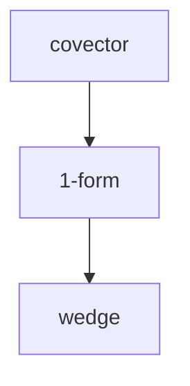

# Learner files — the state layer

All session state lives in the **learner's working directory**, not in this skill
repo. These files are what let a session survive interruption, and what let
another agent resume the same teaching relationship instead of restarting it.

```
.alvar/
  LEARNER.md                 # how this mind wants to be taught
  maps/<slug>.md             # probe results for one goal
  sessions/<date>-<slug>.md  # plan + steps + quizzes
  visuals/<slug>-<n>.svg     # diagrams that earned their place
```

Create `.alvar/` on first use. Nothing here is a deliverable — it's the
persistence layer (and the portable stand-in for the Obsidian markdown log, if
`md-log` is linked: the session file is the source of truth, the log is the view).

## Read order at session start

1. `.alvar/LEARNER.md`
2. the map for this goal, if it exists
3. the last session file for this goal, if it exists

If the map and session are fresh for *this exact goal*, offer to resume instead of
re-probing. Never silently re-probe a goal he already answered — that's reteaching
his own state back at him.

## LEARNER.md

If missing, run `learn-profile` or write a stub from `assets/LEARNER.md` and ask
3–5 questions to fill it. Do not invent a personality, hobbies, or preferences.

It controls: voice and density, how he wants struggle, what he already treats as
solid, and whether he wants visuals, mermaid, LaTeX, or a long markdown log.
Read it every session; it overrides the defaults in `SKILL.md` where they conflict
on *style* (never on the teaching principles).

## Map file

```markdown
# Map — <goal>

Updated: <ISO date>
Goal: <one sentence>

## Strands
| strand | status | evidence |
|--------|--------|----------|
| line integrals | known | Q2 correct, explained the work |
| Stokes | edge | recognized the statement, missed the Faraday link |
| differential forms | unknown | said so |
| SR field mix | blocked | "I don't know", twice |

## Quiz log
- Q1 [line integrals] C — correct
- Q2 [Stokes] A — wrong: swapped the orientation
```

Status: `known` | `edge` | `unknown` | `blocked`.
`blocked` = he said he doesn't know, or the question needed a tool you don't have.

A strand is only `known` with a floor *and* evidence of the ceiling above it (see
`SKILL.md` → Phase 1). One lucky correct answer is not a `known`.

## Session file

````markdown
# Session — <goal>
Date:
Model:
Goal:

## Plan


## Log
### Node: covector
- motivated by:
- taught: (Socratic | expository)
- visual:
- quiz: Q3 — correct / wrong (what he picked and why)
- result: lock-in | retry | insert-prereq

### Node: 1-form (inserted prerequisite)
...
````

## At the end

Update, every time, before you stop:

- **map** — statuses that changed, with the evidence
- **session** — which nodes locked, which are mid-retry, which prerequisites were
  inserted and why
- **next node** — by name, so resuming is one step, not a re-plan

State it in chat too: what locked, what is still `edge`, what comes next. Never
end on "let me know if you want to continue" with the state only in the transcript.
